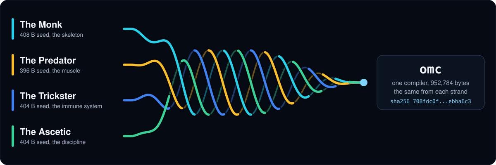

# Omega


**No more out-of-memory. A 35B model up in about a minute. Straight to the metal.**

Omega is a programming language, and a compiler for it that is written in Omega itself. It compiles a model
server into one small static file that drives the GPU directly. This is why you would want it:

| What you get | What was measured | Record |
| --- | --- | --- |
| **No more out-of-memory** | The server takes its memory once, at startup. The Inkling-2-Mini server holds a fixed table of 8 stream slots and no heap. In its live self-test on one NVIDIA GB10 the 9th concurrent request was answered with HTTP `503 server_busy`, and a retired slot was reused. | [om/gpu/inkling2/README.md](om/gpu/inkling2/README.md) |
| **A 35B model up in about a minute** | The 34.7 GB Qwen 3.6 35B-A3B model loaded cold in 43 to 72 seconds, in three recorded windows on one GB10. | [evidence/OLLM-HELIX-CLOSED-LOOP-20261121](evidence/OLLM-HELIX-CLOSED-LOOP-20261121/README.md) |
| **Speed on real weights** | The same 35B model decoded at 67.71 tokens per second with real weights (a 24-token run; five kernel variants produced the same 24 tokens). | [evidence/HELIX-BRAID4-RSI-JIT-20261121](evidence/HELIX-BRAID4-RSI-JIT-20261121/README.md) |
| **One small file** | The 35B runner is one 281 KB statically linked AArch64 ELF. `ldd` reports `not a dynamic executable`. | [om/gpu/q36/README.md](om/gpu/q36/README.md) |


## What you do not need

No CUDA. No HIP or ROCr. No Vulkan. No OpenCL. No PyTorch. No Python. No libc.

The GPU programs load no shared library, so none of those is in the process. On NVIDIA GB10 the program
opens `/dev/nvidiactl`, `/dev/nvidia0` and `/dev/nvidia-uvm` itself. What stays in place below it is NVIDIA's
open kernel modules and signed GSP firmware ([om/gpu/q36/README.md](om/gpu/q36/README.md)). On one AMD
Instinct MI300X an Omega launcher ran a 27B model with no HIP, no ROCr and no PyTorch in its process; a Python
script prepared the dispatch plan beforehand on the CPU
([the run record](https://interplane.io/drakestapleton/CUDApp/blob/main/evidence/amd-qwen38-native-refusal-20261113/README.md)).

## Why it is different: four strands

Omega does not ask you to trust one compiler binary. It grows four compilers, each from its own hand-written
seed of about 400 bytes of machine code. The four strands must arrive at the same compiler, bit for bit.



| Strand | Seed | What it is for |
| --- | --- | --- |
| The Monk | 408 B, `seed/rung0/seed0.hex` | The skeleton: the reference compiler and the proof verifier. It refuses on one wrong bit. |
| The Predator | 396 B, `seedB0.b0` | The muscle: an optimizing compiler that hunts for faster GPU kernels. |
| The Trickster | 404 B, `seedC0.c0` | The immune system: it attacks the proof gate. Its checks are twelve host adversarial controls and three guards that came from failures observed on silicon. |
| The Ascetic | 404 B, `seedD0.d0` | The discipline: zero-swap scheduling with warp-yield pacing. |

The four converge on `seed/out/omc` (952,784 bytes, SHA-256
`708fdc0f81866594ed6df2f492b7a8a6bc7456f2d733a838b7f840549ebba6c3`). One faulty strand is quarantined and
regrown from its seed. When fewer than three of the four agree, the build stops. The commands and the records are in
[seed/helix/README.md](seed/helix/README.md).

## Serve a model yourself

`q36-35b` is an OpenAI-compatible HTTP server for Qwen 3.6 35B-A3B. You need an NVIDIA GB10 (a DGX Spark)
running 64-bit Arm Linux, and the model weights. Run these from the root of this repository, with
`Q36_MODEL_DIR` set to the folder that holds your copy of the weights:

```sh
export Q36_MODEL_DIR="$HOME/models/qwen3.6-35b-a3b-fp8"
sh seed/omega-from-seed.sh
sh om/gpu/q36/build.sh build/q36
sh om/gpu/q36/install-spark.sh .
"$HOME/.local/bin/q36-35b" --self-test
"$HOME/.local/bin/q36-35b" --port 18091
```

[om/gpu/q36/README.md](om/gpu/q36/README.md) has what each step does and what was verified.

## What these numbers are, and are not

They were measured on one NVIDIA GB10, each in the run its record names. The compiler in this repository
makes programs for 64-bit Arm Linux. The website has the prebuilt compiler and a curl install:
[interplane.io/omega](https://interplane.io/omega/).

## What Omega is

Omega is the language of Sovereign Intelligence (SI), my name for the whole stack: the language, the runtime,
the GPU layer and the models that run on them.

The aim is one path a person can inspect from start to finish. A hand-written seed of a few hundred bytes grows,
one small step at a time, into the compiler. That compiler is meant to build everything else, with no step
left as a black box.

This project is unfinished: part of it is still older C code. This page says what works, what is old and what
has not been run yet.

## UXL one command

```sh
git clone https://interplane.io/drakestapleton/omega-mv.git && cd omega-mv && ./uxl-run.sh
```

On Windows, the same clone, then `.\uxl-run.ps1`. If WSL2 is installed, that script runs `./uxl-run.sh` inside it. If not, it runs the same checks here.

`./uxl-run.sh` detects the OS, the CPU, and which backends are present, prints that at the top of the log, and adapts. x86 Linux uses qemu-aarch64 when binfmt is registered. arm64 Linux runs `omc` natively. macOS runs the checks that do not need `omc` and marks the rest NOT_RUN. Native Windows without WSL does the same, and the hint is `wsl --install -d Ubuntu`. When a toolchain package is missing, the log prints one install command for that distro and does not run sudo. `./uxl-run.sh --install-deps` is the switch that runs it. SPIR-V validation, execution (`cl` and `vk`), and conformance checking all run directly in pure seeded Omega (`gpu/spirv/emit.om`, `val.om`, `run.om`, `conform.om`) with no `spirv-tools`, OpenCL ICD, Level Zero, Vulkan, or lavapipe dependency. The process exits 0 when nothing FAILed. NOT_RUN is not a failure. What the run checks is in [docs/UXL.md](docs/UXL.md).

## Where it stands

| Part | Where it stands | Read more |
| --- | --- | --- |
| The compiler, written in Omega | Works. It is rebuilt from the seed and makes programs for 64-bit Arm Linux. | [seed/README.md](seed/README.md) |
| Programs for 64-bit Arm UEFI firmware (`target a64efi`) | Implemented. Exercised on one physical DGX Spark and under QEMU/EDK2. | [docs/A64-EFI.md](docs/A64-EFI.md) |
| Programs for Intel and AMD processors | Candidate. This project's own checks of the Linux programs ran in an emulator only. One firmware program ran once on a real iMac, recorded in [docs/X86-EFI.md](docs/X86-EFI.md). | [docs/X86-LINUX.md](docs/X86-LINUX.md) |
| Output for web browsers (WebAssembly) and for SPIR-V, a common format for programs that run on graphics cards | In the compiler chain. The SPIR-V output has run on a processor only, not on a graphics card. | [docs/SPIRV.md](docs/SPIRV.md) |
| The GPU layer, "Omega GPU" | Moving here from CUDA++, my earlier GPU project, one piece at a time, as Omega only (AMD, NVIDIA, SPIR-V, HW, driver and runtime slices are here). | [gpu/README.md](gpu/README.md) |
| Sovereign Intelligence pure-Omega layers | Integrated here as pure `.om` units built by `seed/out/omc`, indexed in [si/STACK.tsv](si/STACK.tsv). | [si/README.md](si/README.md) |
| Older C code | Still here. Each piece is replaced by Omega and then removed. | [The list of what is left](docs/migration/C-TO-OM-INVENTORY.md) |
| Earlier runtime and numeric results | History. Each one is tied to the exact version in its receipt, the saved record of a check. | [ENGINEERING-NOTES.md](ENGINEERING-NOTES.md) |

The road to version 1.0 is in [docs/ROADMAP-1.0.md](docs/ROADMAP-1.0.md).

## Get a copy

The [project page on Interplane](https://interplane.io/drakestapleton/omega-mv) shows the files, the history
and how to get a copy on your machine.

## Try it

You need a 64-bit Arm Linux machine. The compiler is the file `seed/out/omc`. This writes a three-line
program, compiles it and runs it:

```sh
printf 'fn main to int\nret 7\nend\n' > seven.om
seed/out/omc < seven.om > seven
chmod +x seven
./seven; echo $?
```

It prints `7`, the number the program returns.

To rebuild a fixed, published version of the compiler from the seed on your own machine, and check every step
against published fingerprints without changing any tracked file (this needs a git copy that contains the one
commit the challenge pins; a normal clone has it, a zip download does not):

```sh
sh seed/challenge/run.sh
```

[seed/challenge/CHALLENGE.md](seed/challenge/CHALLENGE.md) names that version and explains what the run
proves. It is an earlier version than the `seed/out/omc` used above. The command that rebuilds today's
compiler from the seed is `sh seed/omega-from-seed.sh`; run it in a spare copy, because it writes into the
project folder.

- The language: [docs/one_layer/OMEGESE.md](docs/one_layer/OMEGESE.md)
- The newer language profile and what it guarantees (detailed, for engineers):
  [docs/one_layer/OM2-TUTORIAL.md](docs/one_layer/OM2-TUTORIAL.md)
- One small program, explained line by line (written for an older version of the compiler):
  [docs/TEACH_OMEGA.md](docs/TEACH_OMEGA.md)

## Core ideas

These are what the project is built toward. The notes under each say how far it has come.

- **Smart is not trusted, and intelligence is not authority.** Trust comes from checks that passed, never from
  how capable something is.
- **Meaning is permanent; the way it is written is disposable.** A program is meant to be named by a
  fingerprint of its written form once the form is tidied, so respellings such as spacing and names share one
  name. Today the older C code computes this name. Programs built with `seed/out/omc` do not get one yet.
  [spec/program-identity.md](spec/program-identity.md) says exactly how far the idea goes.
- **Pure computation is kept apart from effects.** The aim is that anything that changes the outside world
  needs a stated permission and leaves a receipt, a saved record of what was done. Programs built with
  `seed/out/omc` do not produce such receipts yet.

## Rules I keep

- Omega is the only language for new work here. Code in C, Rust or shell that remains is unfinished migration,
  not the plan.
- A claim counts only with the exact command, its result and a fingerprint of what it produced.
- Evidence is never edited or overwritten. Failed experiments stay.
- A result from a run that did not use the target chip, or from an emulator, is never reported as a hardware
  result.
- Results use fixed words: PASS, FAIL, NOT_RUN (the check was not run), BLOCKED_HARDWARE (it needs a machine
  that was not available), BLOCKED_OPERATOR (it needs a decision from me), MISSING_IMPLEMENTATION (the code
  does not exist yet).
- Builds are offline and in-house.

## What is in each folder

| Folder | What it holds |
| --- | --- |
| `seed/` | The compiler chain, from the hand-written seed up to `omc`. |
| `gpu/` | Omega GPU: the pure-Omega GPU layer (AMD, NVIDIA, SPIR-V, HW, driver and runtime slices) and its checks. |
| `aienux/`, `core/`, `bridge/`, `protocol/`, `train/`, `apps/`, `si/` | Pure-Omega Sovereign Intelligence layers (OS, runtime/agent core, compatibility, networking/protocols, training/Omega LLM, apps/sites, front-door/ledger), each gated by its `units-gate.om`. |
| `spec/`, `docs/` | The language and its documents. |
| `tests/` | The gates. A gate is a check that must pass before a change lands. |
| `evidence/` | Receipts, each tied to an exact version. |
| `src/` | The older C implementation that is waiting to be replaced. |

[FOLDERS.md](FOLDERS.md) covers every folder and the rules each one keeps.

## How it fits with the other projects

- [CUDA++](https://interplane.io/drakestapleton/CUDApp) holds the parts of the GPU layer that have not moved
  into `gpu/` yet.
- [Omega Bridge](https://interplane.io/drakestapleton/omega-bridge) is the compatibility layer. It lets
  programs in other languages call compiled Omega.
- [aien-architecture-mv](https://interplane.io/drakestapleton/aien-architecture-mv) holds the decision records
  and the order of the work.
- [aienux](https://interplane.io/drakestapleton/aienux) is the core of AienOS, the operating system Omega is
  meant to run on.

## Papers

- [Omega: A Programming Language Built for Verified Programs](https://doi.org/10.5281/zenodo.23547810)
- [The Token Is the Instruction](https://doi.org/10.5281/zenodo.23644702)
- [A Call to Humanity: Breaking the CUDA Stranglehold on the Hardware Market](https://doi.org/10.5281/zenodo.23614483)

Author: Drake Stapleton, [ORCID 0009-0002-6890-7111](https://orcid.org/0009-0002-6890-7111). To cite this
work, use [CITATION.cff](CITATION.cff).

## Human-Directed Agentic Engineering

I set the goals, the architecture, the limits, what counts as done and where to stop. AI agents write the
code, run the checks, find what failed and fix it inside those limits. I stay responsible for every claim and
every release. [CONTRIBUTORS.md](CONTRIBUTORS.md) lists which model did what.

The method is described by Gregory M. Kurtzer in
[*Ginux: Building an Independent Kernel That Runs Linux Userspace through Human-Directed Agentic Engineering* (2026)](https://doi.org/10.5281/zenodo.23682548).
I cite it for the method only. It does not change authorship or the qualification of earlier experiments.

## Contributing

The way to send a change to this project through Interplane is still being built. Until it is ready, write to
aien@aienos.com. Bring the exact command you ran and what it printed, for the exact version you changed.
Receipts name the exact commit and refuse a dirty tree, and existing evidence is never edited in place.
Someone who did not write the change reviews it before it lands.

## Licence

Apache License 2.0. See [LICENSE](LICENSE) and [NOTICE](NOTICE).

## For engineers

The detailed notes that used to be on this page are in [ENGINEERING-NOTES.md](ENGINEERING-NOTES.md): the full
state of each part, the checks for the older C code, and how the host checks behave on a busy machine.
